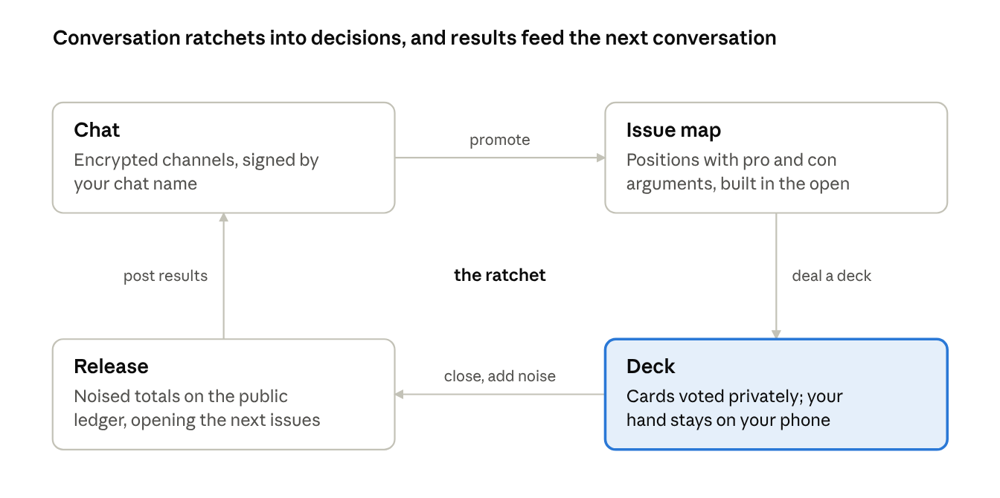
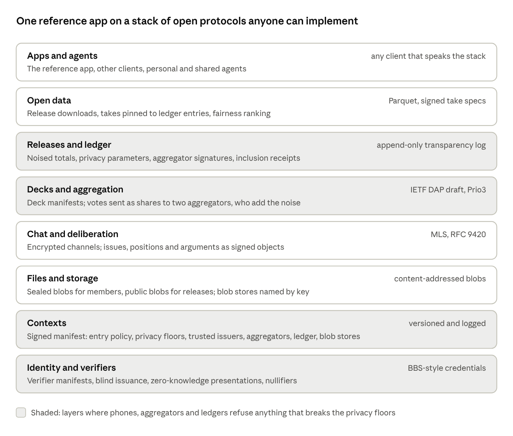
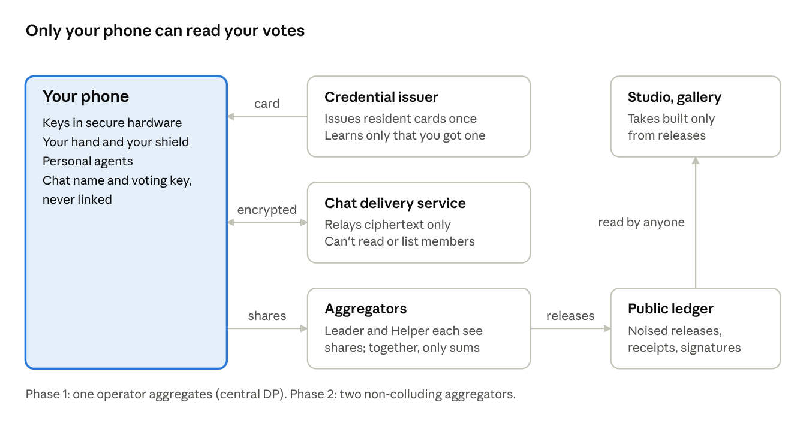
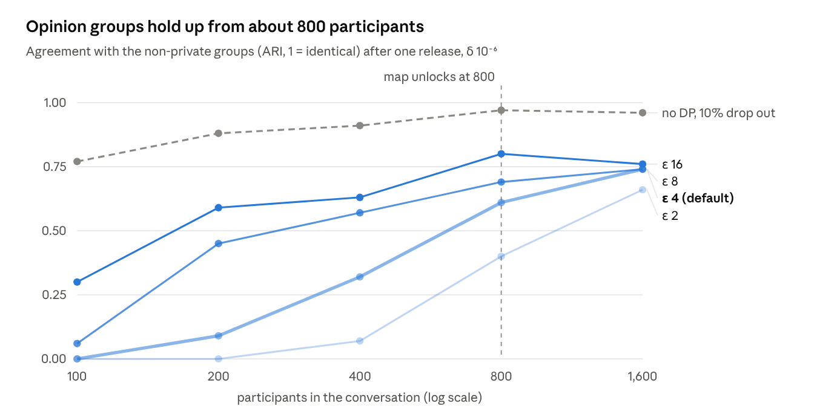
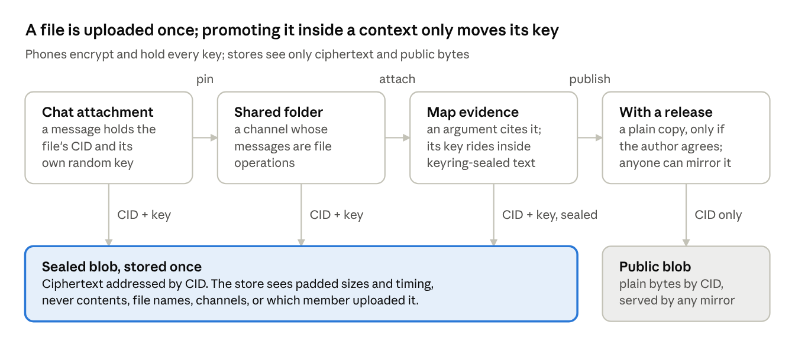

# Hum — Design

Oct 6, 2026 · @Peter Stein

## Vision and the ratchet

This is a chat app with superpowers: group conversation ratchets into structure, structure into private votes, and the results back into conversation, without anyone's vote ever being attributable to them.

Each arrow is a promotion people choose to make, and agents make each one cheaper. The deck is the only stage where votes exist; everything after it is noised totals.

- **The public dataset is the releases, never the votes.** Anything built on a release costs no privacy.
- **Chat is attributable; votes aren't.** The two identities are separate keys and are never linked.
- **The protocol sets the privacy floors.** Organizers shape conversation, not exposure.
- **An agent's privileges come from where it runs,** and agents never vote.
- **Fun is a feature,** as long as it never nudges an answer.
- **Native app only,** with keys in the phone's secure hardware.

## Protocol stack

The product is a stack of open protocols with one reference app. Anyone can run a verifier, an aggregator, a ledger or a client, and the privacy floors are enforced by the phones, aggregators and ledgers that would have to break them.

Each layer is specified on its own, so a context can swap any one of them without trusting the others more.

- **Floors live at the edges.** Phones refuse decks whose manifest breaks their floors (ε per release, minimum voters, the yearly shield). Aggregators refuse to release below the minimums, and ledgers refuse entries that don't conform. No central server has to be trusted to keep them.
- **Everything is a signed, versioned, logged manifest:** verifiers, contexts, decks and releases. Any change is visible to anyone.
- **Launched on one network, designed to federate.** Every context starts on the reference network: one ledger and one pair of aggregators. Verifiers are open from day one. Federation later is a manifest change, not a migration, because of the rules in the table below.
- **Standards where they exist, specs where they don't.** MLS for chat, the MIMI content draft for file references, the IETF DAP draft for aggregation, BBS-style credentials for identity. The deck, release, context and IBIS object formats get specs, test vectors and conformance suites.
- **The reference app is one client.** Better clients, bots and analysis tools can be built by anyone.

| Piece | At launch | What keeps it federable |
| --- | --- | --- |
| Aggregators | The operator plus one Helper partner | Each deck manifest names its aggregators by public key, never by hostname |
| Ledger | One reference ledger | Entries are signed and hash-chained with inclusion proofs, so anyone can mirror one and ledgers can later cross-sign each other |
| Verifiers | Open from day one | Trust lists and verifier manifests |
| Chat | The reference delivery service | MLS groups are addressed by key, so the delivery service can be swapped |
| Files | The reference blob store | Contexts name blob stores by key and blobs are addressed by hash, so any store, mirror or member's phone can serve them |
| Cross-context references | Reference network | Global statements, shared verifiers and takes are content-addressed by hash, not by server URL |
| Context data | Hosted on the reference network | A context exports its manifests, issue map and releases (never votes) and can be re-homed |

One rule ties it together: clients accept only what is signed by the keys a manifest names, and never trust the reference servers just for being the reference.

## Core concepts

Everything happens inside a context. A context's conversation moves from chat into decks, and every deck ends in one privacy-protected release.

| Term | What it is |
| --- | --- |
| Context | A group space (a union, a city process, a team) with members, permissions, chat, an issue map and decks. Anyone can create one. |
| Global | The context everyone belongs to. Its shared statements let smaller contexts be compared and mapped together. |
| Channel | An end-to-end encrypted chat room inside a context. An issue channel is tied to one issue. |
| Files | Encrypted shared storage for a context and its channels. It also holds chat attachments and history for newcomers. |
| Issue | A question the group is working on, such as "Ignored repair requests: what do we do?" |
| Position | A proposed answer to an issue. Positions become cards. |
| Argument | A pro or con attached to a position, shown on the back of its card. |
| Deck | A fixed set of cards that opens, collects votes, closes, and gets exactly one release. |
| Card | One statement in a deck, voted agree, disagree or unsure. |
| Hand | Your own votes in a deck. Readable only on your phone. |
| Release | The noised totals published after a deck closes: the only thing that leaves aggregation. |
| Ledger | The public, append-only log of releases, their privacy settings and their receipts. |
| Shield | Your yearly privacy budget, tracked only on your phone. |
| Resident card | An anonymous credential that proves facts (ward, age band) without revealing who you are. |
| Studio and gallery | Where anyone builds charts and arguments ("takes") from releases, and where takes are ranked by how fair every opinion group finds them. |

## Privacy model and trust

Trust is split so that no single party can see how anyone voted: phones hold the keys, aggregators see only sums, and the public sees only noised releases.

Every arrow out of the phone carries something no one else can read alone: a credential, ciphertext, or a share of a vote.

| Party | Sees | Never sees |
| --- | --- | --- |
| Your phone | Everything you did | Anyone else's votes |
| Organizer | Who accepted an invite, a noised daily count, the releases | Votes, or who voted |
| Chat delivery service | Ciphertext, timing, which channel | Content, the member list |
| Blob store | Ciphertext, padded sizes, timing, which context's quota a blob counts against | Contents, file names, channels, which member uploaded or downloaded |
| Aggregators | Phase 1: pseudonymous votes. Phase 2: shares, which reveal nothing alone | Who a pseudonym belongs to |
| Credential issuer | That you got a resident card | What you join, say or vote |
| The public | Releases on the ledger | Anything about one person |

- **Who we defend against:** the operator, a breach or subpoena, organizers, other members who know you (they have the most side information), and the public.
- **Three identities, never linked:** a resident card (an anonymous credential with selective disclosure, issued once), a per-context voting pseudonym (a Semaphore-style group proof with a per-context nullifier), and a chat name that signs what you say.
- **Phases:** central DP ships first. Two-server aggregation (Prio3 in the IETF DAP draft, with a Leader and a Helper) replaces it without changing the math, since every release is a sum.
- **Native app only:** the code that handles your keys can't be swapped by a server the way web code can.

## Verifiers

Verifiers are a protocol, not a plugin store. Anyone can run one, including a context's administrators from day one, and each context decides which verifiers it trusts.

| Protocol piece | What it specifies |
| --- | --- |
| Verifier manifest | A signed, versioned description: the issuer's key, the attributes it issues, the evidence it collects, how long it keeps it, how it deduplicates people, how it revokes, and its declared assurance. Every version goes in a public log. |
| Issuance | The phone gets a blind-signed credential carrying the attributes (BBS-style), so the issuer never sees the credential it will later be checked against. |
| Presentation | A zero-knowledge proof that the phone's credentials meet a context's policy, plus a per-context nullifier. Unlinkable across contexts and to the issuer. |
| Policy | A context's entry rule as conditions over issuer and attribute, such as "district in Wards 1–3 from any issuer on trust list X, and on the roster from issuer Y." Published in the context manifest. |
| Revocation | Short-lived credentials re-issued on a schedule, or an accumulator the issuer publishes. |
| Trust lists | Signed lists of issuers that anyone can publish. The platform publishes one for its core verifiers, a federation one for its members' verifiers; contexts reference lists or single issuers. |

- **Custom code can't break unlinkability.** That comes from the cryptography, whatever the verifier runs.
- **Custom code can over-collect evidence.** The defense is transparency: before you submit anything, your phone shows the verifier's manifest and exactly what it asks for, and every manifest change is public.
- **Assurance is declared, then judged.** Releases name the issuers and declared assurance behind their voters; trust lists and track records are how communities judge them.
- **Uniqueness is per issuer.** A context that trusts weak issuers accepts their sybil risk, and can also require a core uniqueness credential.
- **Core verifiers are ordinary participants.** The platform's district, age-band and uniqueness verifiers speak the same protocol and earn trust the same way.
- **Agents get sponsor credentials** through the same protocol, of a type no voting policy accepts.

Attributes still respect the floors: a unit number can gate entry but never appears in a breakdown under the 300-voter cell gate.

## Differential privacy design

Each deck produces one release built only from noised sums, so the same math works whether one operator or two non-colluding servers do the adding. Guarantees are user-level: they cover a person's whole participation in the release, not single votes.

| Release part | What it is | Sensitivity per person | Budget share |
| --- | --- | --- | --- |
| Statement tallies | Agree, disagree and unsure counts per card, plus a participant count | √(K+1), where K = votes counted per person (60 in the prototype) | 15% |
| Covariance | Sum of outer products of unit-length vote vectors over the 60 most-voted statements | 1 | 35% |
| Opinion map | Each phone projects itself onto the published axes and reports one cell of a 24 × 24 grid | 1 | 15% |
| Group tallies | Per-group counts; each phone assigns itself to a group from the published centroids | √K | 35% |

- **Mechanism:** Gaussian noise with ρ-zCDP accounting, δ = 10⁻⁶. One release at ε 4 is ρ 0.254.
- **Everything downstream is free:** clustering on the blurred noisy map, common-ground and representative-statement rankings, synthetic tables and every studio take are post-processing.
- **Rankings must know the noise:** pseudo-counts and z-tests include the published noise level. Naive ranking surfaces statements with few votes that got lucky.
- **Contribution cap:** K trades dropped votes for less noise. Set K at or above the deck size so small decks drop nothing.
- **Schedule:** one release per deck, about four a year per context. zCDP composes below the sum: four releases at ε 4 total about ε 8.5, not 16.
- **Rule of thumb:** with everyone voting on the whole deck, privacy noise on a statement is about 200 × √(statements) ÷ voters points at ε 4 (90% interval), and about half that at ε 8.
- **Small decks:** a tallies-only release gives the whole budget to tallies. 300 voters on 30 statements gets ±2 pts at ε 8 and ±4 at ε 4.

| Feature in a release | Unlocks at |
| --- | --- |
| Statement tallies | 100 voters |
| Common ground | 300 voters |
| Opinion map and groups | 800 voters |
| Breakdowns by attribute (ward, age band) | 300 voters per cell |
| Studio checks against real data | 5,000 voters |

## Evidence from real conversations

Running the DP pipeline on the 18 public [Polis conversations](https://github.com/compdemocracy/openData) with 100+ participants showed that size decides what survives: opinion groups need about 800 participants, while tallies depend on votes per statement.

Below 300 participants, groups don't survive at any ε worth calling private, and they're shaky even without DP. The dashed line is how much groups change, with no DP, if a random 10% of people hadn't shown up.

| Question | Result (one release, δ 10⁻⁶) |
| --- | --- |
| Votes a statement needs for ±5 pts (90%), full release | 545 at ε 4 · 288 at ε 8; a plain 271-person poll has the same sampling error |
| Tallies-only release, 300 voters × 30 statements | ±3.7 pts at ε 4 · ±2.0 at ε 8 |
| Noise-aware vs naive ranking, 1,000–2,000 voters, ε 8 | Representative statements 0.98 vs 0.69 found; common ground 0.72 vs 0.40 |
| Effect of the 60-vote cap on heavy voters | One Austrian conversation's median statement fell from 150 to 48 counted votes |
| Four releases at ε 4 each | About ε 8.5 in total |

Metrics compare the DP output with the same analysis run without noise. "Found" means the share of the top 5 that land in the non-private top 15.

## Contexts, permissions and platform rules

Organizers shape the conversation, but privacy floors come from the protocol and are enforced by every phone and aggregator, so no context can be configured to expose its members.

| Setting | Set by | Options |
| --- | --- | --- |
| Who can join | Organizer | Anyone · invite link · approved list · verified residents of an area |
| Who writes cards | Organizer | Organizers · members, reviewed · any member |
| Who sees results | Organizer | Everyone (public ledger) · members · organizers |
| Who sees the member list | Organizer | No one · organizers · members |
| Mix in Global cards | Organizer | On or off |
| History for newcomers | Organizer | None · shared by an organizer · full channel history |
| File retention | Organizer | Keep until deleted · expire after a set time, per kind of file |
| Minimum voters to publish | Protocol floor | 100 |
| Privacy spend per release | Protocol floor | ε 4.0 |
| Releases per deck | Protocol floor | 1 |
| Yearly shield per person | Protocol floor | ε 20 (placeholder) |

- **Membership is an anonymous group.** The organizer knows who was admitted, never who voted or whether they did.
- **No live counts.** Organizers see a noised daily count of players, so nobody can watch one person vote.
- **Planted members don't break it.** DP holds even if an attacker knows every other vote, which is why the platform doesn't rely on rules like "hide results under 10 people."
- **Small contexts** (under 100–300 voters) get tallies only, or roll their statements up into a parent context or Global.
- **Privacy loss adds up across contexts.** Pseudonyms are per context, so only the phone can total a person's spend and stop counting their votes past the yearly shield.

## Deliberation layer (IBIS)

IBIS gives conversation a shape: issues hold positions, positions carry pro and con arguments, and positions become the cards people vote on privately.

- **Structure:** issue → positions → pro and con arguments, with sub-questions hanging off an issue. Arguments respond to ideas, not to people, so there are no reply threads to turn into flame wars.
- **The card has two sides.** The front is the position. The back shows the strongest pro and con, ranked by how fair every opinion group found them.
- **Measuring persuasion:** you vote, the card flips, and you're asked whether either case changed your mind. Movement per argument is published only as noised totals. Reading the arguments first still counts in the tallies but not in the movement stats. A re-vote reveals more, so it costs more budget.
- **Rating arguments:** "does this move you?", broken down by group, shows which reasons cross the divide. Only the top few arguments per position are rated, or each person rates a sample, to keep noise and budget in check.
- **Authoring:** post a position, pro, con or question under your chat name or unsigned. It is never linked to how you vote. Likely duplicates are flagged for merging, and an argument can be backed by a studio take.
- **After a release,** positions are annotated with support by group and arguments with whom they persuaded. That raises the next issues.

## Chat layer

Chat is the front door: an end-to-end encrypted, Discord-shaped app whose issue channels feed the map, and into which decks and releases post back.

- **Why not Signal groups:** they cap at 1,000 members ([source](https://support.signal.org/hc/articles/360007319331)) and have no channels, roles or structure.
- **Protocol:** MLS ([RFC 9420](https://www.rfc-editor.org/rfc/rfc9420.html)). Its architecture document ([RFC 9750](https://www.rfc-editor.org/rfc/rfc9750.html), April 2025) covers groups from two members to hundreds of thousands. Discord already uses MLS for encrypted voice and video, though not text ([DAVE](https://daveprotocol.com/)).
- **Each channel is its own MLS group.** Keys rotate whenever someone joins or leaves.
- **Promote to map:** any message can become a position, pro, con or sub-question. The author confirms first, since it's their words.
- **Decisions post back:** a new deck appears in its issue channel as a card you can play from, and a release posts a digest.
- **Two identities:** your chat name signs what you say; your voting pseudonym is a separate key that is never linked to it.

| Hard part | Approach |
| --- | --- |
| History for new members | Messages from when you joined; the context's policy can add earlier history as an encrypted archive in its storage |
| Search | Runs on the device |
| Moderation | Reports carry proof the message was really sent (message franking), so moderators act without reading everything |
| Who is in a channel | Membership proven with anonymous credentials; the server can't list members |
| Metadata | The server still sees timing and channel; sizes are padded and the sender hidden where the protocol allows |
| Multiple devices and agents | Each device and each shared agent is a visible MLS member |

## Files and storage

Every context gets encrypted shared storage, and the same store backs chat: attachments, history for newcomers, shared folders and evidence on the map are all blobs only members can decrypt.

Pinning or citing a file re-sends its key, never the file. Publishing it with a release makes a separate public copy, and only with the author's consent.

| What | Stored as | Who can read it |
| --- | --- | --- |
| Chat attachments | Sealed blob | The channel's members |
| Shared folders | Sealed blobs plus an encrypted index | The folder's members |
| History archives | Sealed blob | Newcomers the context's policy admits |
| Issue-map text and evidence | Sealed blob in members-only contexts, public blob in public ones | Members, through the context keyring; anyone, in public contexts |
| Release tables, takes, large manifests | Public blob | Anyone |

- **Blobs, addressed by hash.** The store holds blobs by content ID. Sealed blobs are encrypted on the phone with a fresh key per file, in chunks so large files stream, and padded to hide exact sizes. Public blobs are plain bytes anyone can mirror.
- **Keys travel in references.** A reference carries a blob's ID, key, size and type inside an MLS message or an encrypted folder index, following the external part in the [MIMI content draft](https://datatracker.ietf.org/doc/draft-ietf-mimi-content/). [MIMI's attachments draft](https://datatracker.ietf.org/doc/draft-robert-mimi-attachments/) derives keys from the MLS epoch instead. A key per file means one upload can be pinned to a folder or cited on the map by re-sending its key.
- **A folder is a channel.** Its messages are file operations (add, rename, move, new version, delete), so ordering, authorship and access come from MLS. Phones snapshot it into an encrypted index so newcomers don't replay every operation.
- **Storage backs chat.** The delivery service is a short-term queue and the store is long-term memory. History for a new member or a new device is an encrypted archive written by an existing member's phone, when the context's policy allows it.
- **Rights.** Reading means being in the folder's or channel's MLS group. Writing and deleting follow roles in the context manifest, and phones ignore file operations from members without them.
- **Removal.** Keys rotate when someone leaves, so new files are out of their reach. Files they already received can't be recalled; a sensitive folder can be re-keyed by re-encrypting it and deleting the old copies.
- **Deletion.** Authors delete with a secret only their phone holds, organizers with an order the context signs, and retention limits expire the rest. Deleting the ciphertext makes every copy of its key useless.
- **Blob stores are named by key.** A context names one or more stores, as it names aggregators. Uploads and downloads use anonymous tokens ([Privacy Pass](https://www.rfc-editor.org/rfc/rfc9576.html)) through an OHTTP relay, so a store learns which context, never which member or channel.
- **Moderation.** Message franking covers attachment references, so a report can show moderators the reported file, provably as it was sent.
- **Votes never touch storage.** Ballot shares go only to aggregators, and hands and shields stay on the phone.

## Agents as first-class participants

Agents are visible members whose privileges come from where they run. They make each step of the ratchet cheap, and they never vote.

| Tier | Runs | Sees | Good for |
| --- | --- | --- | --- |
| Personal | On your phone | What you see, including your own votes; nothing leaves the device | "Catch me up on #repairs," "what changed since I voted," "prep me for this deck" |
| Shared | As a channel member, on a member's own hardware or in an attested secure enclave | What the channel sees | Proposing issues from threads, drafting clean positions, merging duplicates, writing the strongest pro and con, posting release digests |
| Public | Anywhere | Releases only | Studio takes and analysis; labeled in the gallery and ranked like everyone else |

- **Agents never vote.** Voting credentials are one per human. An agent can help sort your deck; you cast every card.
- **Agent content is always labeled.** Each agent has an accountable human or organization sponsor and per-sponsor rate limits, because agents are the easiest way to flood an issue map.
- **Adding a shared agent is a visible membership event.** An agent on the operator's servers would quietly undo end-to-end encryption for that channel, so the channel sees where the agent runs.
- **No agent touches raw votes.** Everything an agent does sits on your own device or downstream of releases.

## Open data platform

The public dataset is the releases, never the votes, so anything anyone builds on a release costs no one any privacy.

- **Ledger:** an append-only transparency log, no blockchain. Each entry holds a release, its method and parameters, the budget it spent, the aggregators' signatures and inclusion receipts that let you confirm your votes were counted. It cannot yet prove the noise was drawn fairly.
- **Data access:** releases download as Parquet and are served through an API.
- **Studio:** a chart builder and notebooks working on releases. Error bars come automatically from the published noise, differences within the noise are flagged, and weighting to Census figures is a built-in lens.
- **Gallery:** takes are pinned to a release, so they are reproducible and forkable. They are ranked by whether every opinion group rates them a fair reading, with the same left/right gesture as voting.
- **Competitions and real-data checks:** only for contexts with 5,000+ voters. Each check spends budget, so they need either the central model or queries declared before collection.
- **Synthetic tables:** row-level tables generated from releases. They preserve only the structure a release measured, and their quality is untested.
- **Product analytics:** the operator's own usage data goes through the same private aggregation, and platform usage is published as a context on the ledger.

## Product and UX

The app is dark, data-first and played like a card game, and it ships as a native app only. The clickable prototype is the [UX spike canvas](https://claude.ai/artifact/U1CRFCYEKFnR8DGHvgWnmM): open the Participant & trust page and press Play on Welcome.

- **Swipe deck:** drag right to agree, left to disagree, up for unsure. A stamp fades in as the card leans, and topic meters show which theme the card touches. Buttons do the same for anyone who can't drag, and there is an undo.
- **Vocabulary:** deck, deal, hand, shield, unlocks and resident card, used consistently across the app.
- **Results deck:** when a release lands, you flip through one card per statement with your vote next to everyone's, matched on your phone.
- **Native only:** keys live in the phone's secure hardware. Reproducible builds with their hashes on the ledger let people check the shipped app matches the audited code.
- **Fun without nudging:** unsure is a full answer, the app doesn't react to which way you swipe, and nothing shows a running result before you vote. The "with the majority so far" counter on the results deck may push conformity and needs testing.

## Open questions and risks

The biggest open decision is who operates the platform and who runs the second aggregator, because both credibility and the two-server guarantee rest on it.

- **Operator and Helper:** who runs it, and which independent party runs the second aggregator so non-collusion is believable.
- **Identity:** who may publish verifiers, how their assurance levels are reviewed, and what each issuer learns about who participates.
- **Privacy targets:** ε per release, the yearly shield, and whether any tier protects single votes instead of whole records.
- **Small contexts:** a minimum size, pooling into a parent or Global, or a weaker tier.
- **Honest noise:** nobody can yet verify the noise was drawn fairly; verifiable DP is research-stage.
- **Coordinated people and agents:** sybil resistance stops fake accounts, not organized groups or agent-generated floods of arguments.
- **Self-selection:** weighting helps but doesn't make an opt-in sample representative; the studio has to keep "people here think X" and "the district thinks X" apart.
- **Synthetic tables:** untested beyond the structure a release measures.
- **Encrypted chat at scale:** metadata, moderation and history all get harder as channels grow into the thousands.
- **Files:** whether newcomers get history by default, when removal should re-key a folder rather than only rotate, who pays for large media, and how a store answers takedown requests for content it can't read.
- **Legal:** the open-data license, retention, and how to answer a subpoena.
- **Adoption:** people show up when an organizer acts on results; the platform needs organizers before it needs features.

## Build order and next steps

Hum is built by one person directing agents, so the plan runs in three waves: freeze the contracts, build every layer in parallel against them, then connect everything and attack it. Contracts come first because the release format and ledger can't change once releases exist, and because agents can only work in parallel against interfaces that hold still.

1. **Wave 0, contracts:** body specs for every manifest type, the ballot and credential flow, chat on MLS, storage, and the service APIs; a small Python reference implementation that generates every test vector; and a simulator skeleton that replays Polis votes. Agents draft, a person approves.
2. **Wave 1, build everything at once:** one workstream per layer (manifests and logs, identity, aggregation, ledger and open data, chat, storage, deliberation, the iOS and Android apps, studio and gallery, agents, platform). Each owns its directory, spec and vectors, and merges only with the conformance suite and the simulator passing.
3. **Wave 2, integrate and attack:** the simulator runs the whole ratchet on every change; the crypto and DP code gets twin implementations built from the spec alone; red-team agents try to reconstruct votes, get past the floors and make the log equivocate.
4. **Before real people:** an outside cryptography review, then the first contexts.
5. **Later:** two-server aggregation replaces central DP, and federation lets contexts choose their own aggregators, ledgers and stores.

The prompts for each wave live in the repo's prompts folder, next to snapshots of this doc, the manifest spec and the UX canvas.

- [ ] Create the hum repo from the seed bundle and run the bootstrap prompt
- [ ] Run wave 0 and approve each spec
- [ ] Decide the operator and the second aggregator
- [ ] Set the privacy targets: ε per release and the yearly shield
- [ ] Design the agent screens: catch-up, the facilitator in a channel, the agent membership event
- [ ] Line up an outside cryptography review
