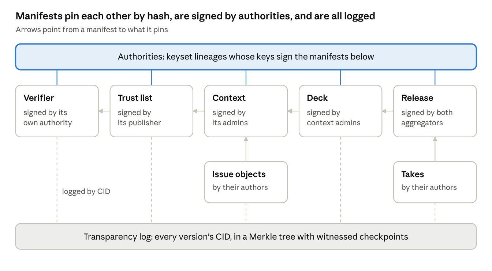

# Hum Manifest Spec — Draft 0.1

Oct 6, 2026 · @Peter Stein

## Scope

A manifest is the one signed, versioned, logged envelope every shared object in the protocol uses. Verifiers, trust lists, contexts, decks, releases, issue-map objects, takes, agent sponsorships and services (blob stores included) are all manifests of different types. This spec defines the envelope; each type's body gets its own spec.

Requirements, each traceable to the [design doc](https://claude.ai/code/artifact/65a5453d-4d95-4084-9bae-f072be3aa62f):

1. **Self-verifying.** A phone can check a manifest offline from its bytes, the signer's key set and a log proof, with no server trusted for being the reference.
2. **Federable.** Authorities, aggregators and ledgers are named by keys, and manifests reference each other by content hash, never by hostname.
3. **Versioned with history.** Every change is a new version that points at the one before it, so anyone can replay a lineage.
4. **Logged.** Every version appears in an append-only transparency log before honest clients accept it, which makes showing different people different versions detectable.
5. **Small and phone-friendly.** Compact binary encoding, bounded sizes, and verification that runs on a phone in milliseconds.
6. **No personal data.** Manifests describe rules, structure and aggregates. Anything a person writes lives in deletable content, referenced by hash.

Out of scope here: credential cryptography, the aggregation protocol, MLS, and each type's body schema.

## At a glance



A release can be traced back to the exact rules it ran under: its deck, the context version, the trusted verifiers, and the keys that signed each one. All of it is in the log.

## Encoding and content addressing

Manifests are deterministic CBOR, and a version's ID is the hash of its unsigned bytes, so the same manifest has the same ID everywhere and co-signers can add signatures without changing it.

- **Encoding:** CBOR with the core deterministic encoding requirements of [RFC 8949 §4.2.1](https://www.rfc-editor.org/rfc/rfc8949.html#section-4.2.1): shortest-form integers, definite lengths, map keys sorted bytewise. No floating point in signed content; rates and ε values are rationals or fixed-point integers.
- **Map keys** are small unsigned integers, assigned per type in the type registry. A JSON view with readable names is derived for people and tools and is never signed.
- **Content ID (CID):** one algorithm byte followed by the digest. `0x01` is SHA-256 over the canonical unsigned envelope (header plus body). The text form is `c` followed by lowercase base32 with no padding.
- **What is hashed:** the unsigned envelope only. Signatures and log proofs travel beside it, so a manifest's CID is fixed before anyone signs it.
- **Blobs:** anything over 64 KiB, such as a release's tables or a long argument, is a separate content blob referenced by CID. Public blobs are plain bytes with a declared media type, such as Parquet or UTF-8 text; sealed blobs are encrypted for a context's members (see Blobs and storage).
- **Size limits:** an envelope is at most 64 KiB, and a manifest references at most 1,024 CIDs. Verifiers reject anything larger before parsing further.
- **Algorithm agility:** new hash or signature algorithms get new algorithm bytes. Old ones stay verifiable forever but can be retired for new signatures.

## The envelope

Every manifest is the same ten-field envelope plus a type-specific body. It travels as a bundle: the envelope bytes, the signatures over its CID, and at least one log inclusion proof. The bundle's wire format (a CBOR map with keys 0 to 4, the proof map, the media type and rules B-1 to B-4) is defined in [`services.md`](services.md), "The bundle"; this spec defines no second one.

| Key | Field | Type | Meaning |
| --- | --- | --- | --- |
| 0 | spec | uint | Envelope spec version; 1 for this draft |
| 1 | type | text | Registry type, such as `deck` or `verifier` |
| 2 | authority | CID | The key-set lineage that controls this manifest and must sign it. Absent in version 1 of a `keyset`, which cannot carry its own CID; that version's authority is its own CID |
| 3 | lineage | CID | CID of version 1; absent in version 1 itself |
| 4 | version | uint | 1 for genesis, then exactly one more than the previous |
| 5 | prev | CID | CID of the previous version; absent in version 1 |
| 6 | issued | uint | Seconds since the Unix epoch. Never used for ordering: log order decides which keyset and which version apply. Informational in most types. A few type rules do read it, and each names who bounds it; see "Where `issued` is load-bearing" under Verification |
| 7 | expires | uint, optional | After this time, no new actions are accepted under this version |
| 8 | refs | map of name to CID | Every other manifest or blob this one depends on, pinned by hash |
| 9 | body | map | Type-specific content, defined by the type's spec |

- **Signatures:** COSE\_Sign ([RFC 9052](https://www.rfc-editor.org/rfc/rfc9052.html)) with a detached payload equal to the CID, one signature per signer. The protected header carries the signer's key ID and algorithm. Ed25519 ([RFC 8032](https://www.rfc-editor.org/rfc/rfc8032.html)) is the only algorithm in draft 0.1.
- **Domain separation:** the ASCII string `hum/manifest/1` is the COSE `external_aad` of every manifest signature, and the detached payload is the CID bytes alone. Each signer therefore signs `Sig_structure = ["Signature", h'', protected, "hum/manifest/1", CID]` (RFC 9052 §4.4; ADR 0082), so a manifest signature can never be replayed as any other kind of signature. The string was `manifest/1` before ADR 0105.
- **Everything that matters is in `refs`.** If a manifest depends on another object, the CID goes in `refs`; free-text pointers in the body don't count.

The readable JSON view of a deck's third version (the body is [`deck.md`](deck.md)'s; `cards` and the card refs are shortened):

```json
{
  "spec": 1,
  "type": "deck",
  "authority": "c4f7q2…k2a",
  "lineage": "c9b1mx…77q",
  "version": 3,
  "prev": "c2ddr8…0vm",
  "issued": 1791259200,
  "expires": 1793836800,
  "refs": {
    "context": "c6a0te…p3e",
    "card/0": "c1e9wz…x8r",
    "card/1": "c7gl…"
  },
  "body": {
    "title": "Fall check-in",
    "opens": 1791259200,
    "closes": 1792800000,
    "topics": ["Housing"],
    "cards": [
      { "kind": 0, "topic": 0, "origin": 0 },
      { "kind": 1, "topic": 0, "origin": 1 }
    ],
    "plan": {
      "rho": "127/500",
      "delta": "1/1000000",
      "parts": { "0": "281/10000", "1": "889/10000", "2": "381/10000", "3": "889/10000", "4": "1/200", "8": "1/200" },
      "cap": 60,
      "minVoters": 100
    },
    "order": 0,
    "kind": 0
  }
}
```

A deck pins its context version and one ref per card. It does not pin aggregators; it inherits the pair from the context version (`deck.md`). Rationals are `[num, den]` arrays in the signed bytes and `"num/den"` in this view (`context.md`, "Conventions").

## Authorities and keys

An authority is a lineage of `keyset` manifests, and its identity is the CID of its first keyset. That makes every authority self-certifying: no registry, DNS name or certificate authority is involved.

- **Who has authorities:** verifiers, trust-list publishers, contexts (their administrators), aggregators, logs, witnesses, delivery services, blob stores, resolvers, relays, issuer hosts, take authors and agent sponsors. Participants don't. Their voting identity lives in credentials, and their chat identity in MLS.
- **Version 1 of a keyset** has no `authority` field, because the authority is the CID of that very version. It is signed by its own `rotate` threshold. Every later version carries `authority` (ADR 0082).
- **A keyset lists** each key's ID, algorithm, public key and role, plus a threshold per role. Roles are `sign` (sign manifests) and `rotate` (publish the next keyset). A typical context uses 2-of-3 for signing and 3-of-5 for rotating.
- **Pre-rotation:** a keyset can commit to the hash of its next keyset's public keys. A thief holding today's signing keys then can't take over the authority, because the next keys were fixed in advance.
- **Rotation:** a new keyset version is valid only when signed by the rotate threshold of the version before it, and it is logged like any other manifest.
- **Which keyset applies:** the latest keyset version logged before the manifest's own log entry. Log order decides; the `issued` time never does.
- **Compromise:** a rotation can declare a key revoked from a given log position onward. Manifests that key signed and that were logged after that position are invalid, while earlier ones stand.
- **Small contexts:** a one-person context may sign 1-of-1, but must still keep a separate rotate key, such as a second device or a printed recovery key.

## Versions and lineage

A manifest changes only by publishing a new version that points at the previous one, and anything that acted under an old version keeps that version's rules. Nothing can be changed under someone after they've acted.

- **Chain rules:** version 1 has no `prev` or `lineage`. Every later version names version 1 as its lineage, the previous version's CID as `prev`, and a version number exactly one higher. The authority stays the same for the whole lineage.
- **Pinning:** manifests reference specific versions, not lineages. A deck pins the context version it runs under, and a release pins the deck version it reports on. If a context tightens its floors mid-deck, the open deck keeps the rules it was dealt with, and the next deck picks up the new ones.
- **Frozen fields:** each type spec says which body fields may change between versions. For example, everything in a deck but its closing time is frozen from version 1 (`deck.md`); only `closes` can move, and only later.
- **Forks are equivocation:** two different versions with the same lineage and version number are never both valid. Clients accept whichever was logged first, reject the other, and mark the authority as equivocating.
- **Retiring:** a final version marked retired ends the lineage; no later version is accepted. Draft 0.1 assigns no envelope key to the retired marker or to the successor pointers below; see Open questions. Until one is assigned, `take.md` and `agent-sponsor.md` carry a body field `retired`, and a deck, context, verifier or trust-list lineage cannot be retired.
- **Moving to a new authority:** the old lineage's final version names a successor lineage, signed by the old authority. The successor's version 1 names the lineage it supersedes. Both are logged, so the handover is public.

## Transparency logs

Every manifest version must be in an append-only log before honest clients act on it, and logs hold hashes, never content. That makes split views detectable while keeping content deletable.

- **Structure:** a Merkle-tree log in the style of Certificate Transparency ([RFC 9162](https://www.rfc-editor.org/rfc/rfc9162.html)). Each entry is a manifest's CID with its type and authority, so readers can filter. The log signs checkpoints: tree size plus root hash.
- **Proofs:** an inclusion proof shows an entry is in a checkpoint's tree; a consistency proof shows a newer checkpoint extends an older one without rewriting it.
- **Witnesses:** independent parties cosign a checkpoint after checking it is consistent with the last one they saw. Clients trust a checkpoint only with at least 2 witness cosignatures in draft 0.1. A log that showed different trees to different people would need its witnesses to collude.
- **Phones keep checkpoints.** Each phone stores the latest checkpoint per log and checks consistency on every update. Phones in the same context also exchange checkpoint hashes inside their encrypted channels, which catches a log that is lying to one group.
- **Proof before action:** a phone won't vote under a deck version, present a credential to a verifier version, or display a release until it holds an inclusion proof against a witnessed checkpoint. A promise to log isn't enough.
- **The ledger is a log.** "The ledger" in the design doc is a log whose entries are release manifests, plus the content store holding their tables.
- **Deletion:** text people write (positions, arguments, takes) and large data live in content stores, referenced by CID. Deleting content removes the bytes; the CID stays in the log as a commitment, and clients show the item as removed. Append-only history and the right to delete coexist because manifests never carry personal data.
- **At launch:** one reference log with witnesses run by independent organizations. Context manifests already name the logs they accept, and a manifest may be logged in several, so more logs are a configuration change.

## References and resolution

A reference is a CID, and any copy of the bytes that hashes to it is as good as any other, so content can come from the reference servers, a mirror, or another member's phone.

- **Pinned, not floating:** `refs` always names a specific version's CID. Following a lineage to its latest version is a separate, explicit lookup against the log.
- **Location hints are unsigned.** A bundle may carry URLs where referenced bytes can be fetched. Hints sit outside the envelope, can't change a manifest's meaning, and are never trusted.
- **Resolvers:** anything that serves bytes by CID. The reference network runs one, anyone can mirror, and phones in a context can share cached manifests with each other.
- **Lineage lookup:** to find the latest version of a lineage, a client asks a log for entries with that lineage and checks the chain from version 1. It never trusts a server's claim of what is latest.
- **Dangling references:** a referenced blob that was deleted resolves to nothing. Clients show it as removed. A manifest whose required references can't be resolved isn't acted on.
- **Cycles:** references form a directed acyclic graph by construction, because a CID can only name bytes that already exist.

## Blobs and storage

Blobs are the bytes that manifests and messages point at. Public blobs are plain and anyone may mirror them; sealed blobs are encrypted on a member's phone, and their keys never appear in a manifest, a log or a request to a store.

| Class | Holds | CID covers | Key travels in |
| --- | --- | --- | --- |
| Public | Release tables, takes, large manifest fields, issue-map text in public contexts | The plain bytes | No key |
| Sealed, from messages | Chat attachments, folder indexes, history archives | The ciphertext | A sealed reference inside an MLS message or another sealed blob |
| Sealed, from manifests | Issue-map text and evidence in members-only contexts | The ciphertext | The context keyring, delivered over MLS |

- **Sealed format.** The phone pads the plaintext with Padmé ([PURBs paper](https://arxiv.org/abs/1806.03160); at most 12% overhead), then encrypts it with AES-128-GCM under a fresh random key, in 64 KiB chunks. Each chunk's nonce comes from its index and a last-chunk flag, so files stream, ranges decrypt on their own, and truncation is caught.
- **Sealed CIDs.** A one-byte format header (0x01: AES-128-GCM, 64 KiB chunks) precedes the chunks, and the CID is SHA-256 over the whole ciphertext. A store can check what it holds without being able to read it.
- **Sealed reference.** CID, algorithm, key, plaintext size, media type, file name, plaintext digest and expiry. These map onto the external part in the [MIMI content draft](https://datatracker.ietf.org/doc/draft-ietf-mimi-content/), with the CID in place of its URL. A reference travels only inside an MLS message or another sealed blob, and re-sharing a file means re-sending its reference.
- **Sealed blobs in manifests.** A manifest pins a sealed blob in refs like any other blob and names, in its body, the keyring epoch that decrypts it. Non-members see a CID and nothing more, so members-only issue maps can be logged without exposing their text. An argument's sealed text can itself carry sealed references, which is how evidence from chat is cited without a new upload.
- **Keyrings.** A context keyring is a list of keys, one per epoch, held by members' phones. When someone is removed, the next key is exported from the all-members MLS group (label hum/keyring/1), and new objects use it. Newcomers receive earlier keys only if the context's history policy allows it.
- **Store protocol.** Four operations: put (the store recomputes the CID and rejects a mismatch), get by CID, get a byte range, and delete. Each request carries an anonymous token ([Privacy Pass, RFC 9576](https://www.rfc-editor.org/rfc/rfc9576.html)) issued against a context membership proof, and goes through an OHTTP relay. Stores enforce quotas per context and rate limits per token.
- **Deletion.** At upload the phone commits to the hash of a delete secret that only it keeps; presenting the secret deletes the blob. A context can also delete with an order signed by its sign threshold, and stores expire blobs at the retention declared at upload, which can't exceed the context's policy.
- **Votes never touch storage.** Ballot shares go only to aggregators, and hands and shields stay on the phone. The conformance suite checks that a client writes neither to a blob store.

## Verification

Before acting on a manifest, a phone runs these steps in order and stops at the first failure. Everything is checkable offline from cached keysets and checkpoints.

1. **Size:** the envelope is at most 64 KiB.
2. **Canonical form:** decode it, re-encode it deterministically, and reject it unless the bytes match exactly.
3. **CID:** compute the content ID from those bytes.
4. **Type:** the type and spec version are known, and the body matches the type's schema.
5. **Keyset:** resolve the authority's keyset lineage and take the version in force at the manifest's log position.
6. **Signatures:** a threshold of that keyset's `sign` keys signed the CID under `hum/manifest/1` (as "The envelope" defines), and none of them was revoked before the manifest's log position. Three types vary this step. A `keyset` is signed by the `rotate` threshold of the previous version, and version 1 by its own. A `release` needs two thresholds: the `sign` threshold of the envelope's `authority` (the Leader) and the `sign` threshold of the authority its body names as `helper`, counted separately, with no public key in both keysets (`release.md` R2, R9). A participant-authored object (`issue`, `position`, `argument`, and a `take` written by an agent) carries an authorship proof in place of authority signatures, checked as `issue-map.md` IM-6 and `take.md` TK-5 define.
7. **Log:** an inclusion proof against a checkpoint with enough witness cosignatures, consistent with the checkpoint the phone already holds.
8. **Lineage:** either this is version 1, or `prev` resolves to a logged version one lower with the same authority, and no other version with this number was logged first.
9. **References:** every required reference resolves and passes these same steps. Results are cached by CID, so a deck usually costs a handful of checks. A referenced manifest is verified as of its own log position, never against the verifier's clock: the keyset, and any verifier version a logged proof depends on, are the ones in force at that position, and step 11 applies only to the manifest being acted on. A membership proof or sponsor proof inside a logged object is checked by the logged-presentation rule of `credentials.md`, "Validity" (ADR 0101), so an object does not stop verifying when its author's card expires.
10. **Type rules:** frozen fields unchanged from `prev`, and the privacy floors in the next section.
11. **Expiry:** for a new action, such as a vote, the current time is before `expires`.

Aggregators run all eleven on the deck and context before accepting a single share. A log runs, before appending: steps 1 to 6 and 8; step 9 as "every manifest-valued reference is already in this log and of the right type", resolving no blobs; and step 10 for every type, each rule that needs only the envelope, the previous version, the log's history and its copies of referenced manifests (`services.md`, "What the log runs" has the table per type). That includes the floors on contexts, decks and releases, `context.md` C16, and the clock checks below. It skips step 7, because the entry is not logged yet, and step 11.

**Where `issued` is load-bearing.** Log order, never `issued`, decides ordering and which keyset applies. These rules read `issued`, or the time of submission, as a time, and each has a party that bounds it:

| Rule | Reads `issued` for | Bounded by |
| --- | --- | --- |
| `release.md` R13 | Version 1 within 30 days of `closes`; every version at or before the deck's `expires`; `roundDeadline` | The Helper's clock (within one hour, before it signs) and the ledger's clock against the `expires` of the deck version the release pins |
| `release.md` R10, R14 | The 365-day windows for rating releases and `rhoYear` | The same |
| `credentials.md` "Validity", logged presentations (`issue-map.md` IM-6, `agent-sponsor.md` AS-8) | Which issuer epoch a stored proof must show | The log of record's clock at submission, within 3,600 seconds. No witness checks it |
| `issue-map.md` unsigned slots (IM-15) | The rate-limit window | The log's clock at submission: current or previous window |
| `deck.md` D16 | Not `issued`: the time of submission. A deck version above 1 is refused once the previous version's `closes` has passed | The ledger's and each aggregator's clock |
| `verifier.md` rule 30 | Not `issued`: the time of submission. A new attribute's `fromEpoch` is within `E_now + 1` to `E_now + 2` | The clock of the log that accepts the verifier version. No later verifier re-checks it; a log that skips it locks existing holders out until handover |
| `agent-sponsor.md` AS-6, `issue-map.md` IM-13 | `expires` at most 90 or 30 days after `issued` | Nobody; a back-dated `issued` only shortens the object's own life |

## Type registry

Draft 0.1 defines the twelve type names in this table. Each gets its own body spec; this table fixes who signs each one and what it pins.

| Type | Signed by | Key body fields | Pins in `refs` |
| --- | --- | --- | --- |
| `keyset` | Rotate threshold of the previous version (version 1 signs itself) | Keys, roles, thresholds, next-key commitment, revocations | Previous keyset |
| `verifier` | Verifier authority | Issuer keys by epoch, host keys, attributes issued, evidence collected, retention, deduplication method, revocation method, validity, declared assurance, code description | Code, build recipe, profile binary and public dataset blobs; no other manifest |
| `trust-list` | Publisher authority | Accepted verifier authorities, the attributes accepted from each, and scope | — (names authorities, which follow their own lineages) |
| `context` | Context authority | Entry policy, privacy floors, accepted logs, aggregator authorities, blob store authorities, storage policy (retention, history for newcomers, size limits), chat group IDs, Global statements mixed in | Trust lists, parent context version |
| `deck` | Context authority | Title, open and close times, cards, release plan (parts with a ρ each, contribution caps, minimum voters), kind | Context version; one `card/<i>` ref per card, with optional `pro` and `con` argument refs; `source` release for a rating deck |
| `release` | Both aggregator authorities: `authority` is the Leader and the body field `helper` names the second | Mechanism, `helper`, stage, ρ and δ spent, noised participant count, receipt roots, accepted verifiers and their declared assurance | Deck version, table blobs, keybox, receipt root blobs |
| `issue`, `position`, `argument` | One of four author forms (`issue-map.md`): the context's `sign` threshold; the author's chat key with a membership proof; a membership proof alone; an agent key. `authority` is the context. The proof travels in the bundle's `authorship` field | Kind, author form, edit key, state, text blob and its keyring epoch when sealed | Context version, parent lineage, text blob, sponsor (agents) |
| `take` | The author's own authority at its `sign` threshold, or an agent key under its sponsor's authority | Author form, query and chart spec | Release versions it uses, text blob, sponsor (agents) |
| `agent-sponsor` | Sponsor authority | Agent public key, tier, where it runs and its attestation, capabilities, rate limits | Verifier version (when a sponsor proof is present), attestation report |
| `service` | The service's authority | `kind` (`log`, `witness`, `aggregator`, `issuer`, `delivery`, `blob-store`, `resolver`, `relay`, `gallery`), endpoints (location hints, never trusted), OHTTP key configuration, accepted token issuers, limits, retention, jurisdiction; kind-specific fields from key 16 (`services.md`; `storage.md` §7 for stores) | — |
| `blob-store` (retired name) | — | Replaced by `service` with `kind: blob-store` (ADR 0072). No manifest of this type is valid in draft 0.1 | — |

- **Naming an authority** rather than a version is allowed only for keysets, because authorities are stable names whose current version the log determines.
- **Two signers on a release:** the envelope has one `authority` field, which is the Leader; the release body's `helper` field names the second aggregator authority, and both must be the pair the pinned deck's context names. Each aggregator signs with its own keyset's `sign` threshold, both sets of signatures sit in the one COSE_Sign, and a verifier counts distinct keys per keyset. One aggregator alone can't publish a release, and the ledger refuses a version that lacks either threshold (`release.md` R9).
- **Participant-authored objects** don't need the context to sign them; proving membership is enough. Their text is a blob, so the author can delete it later.
- **New types** are added by publishing a type spec and registering a type name. Clients ignore types they don't know, and refuse manifests whose required references are of unknown types.

## Privacy floors

Floors come in three layers that can only get stricter: protocol minimums built into every conforming client, context floors in the context manifest, and each person's shield on their phone. Every party that would have to break a floor checks it.

- **Protocol minimums (draft 0.1):** at most ρ 0.254 per release (ε 4 at δ 10⁻⁶), δ at most 10⁻⁶, at least 100 noised voters to publish (the organizer's noised daily count is the one declared exception: it is served while a deck is open, inside the plan's ρ; `context.md`), one release per deck, a declared contribution cap, and a yearly shield of at most ε 20 per person.
- **Context floors** may be stricter but never looser: a lower ρ, a higher minimum, fewer releases a year. A deck's release plan must satisfy the floors of the context version it pins.
- **Size gates live in the release plan.** A plan lists its parts by tier (tallies, common ground, map and groups). Aggregators compute only the tiers the noised voter count unlocks. Phones charge their shield for the plan's maximum, so an unused tier never costs more than declared.

| Who checks | What | If it fails |
| --- | --- | --- |
| Phone | Deck's release plan against protocol and context floors; the planned ρ against the person's remaining shield | Refuses to vote, or sits the deck out |
| Aggregators | Plan against floors; the noised voter count against the minimum; noise added exactly as planned | Below the minimum, log a final release version with no tables and no receipt pages; otherwise refuse |
| Release ledger | Release parameters against the pinned deck and its floors | Refuses to log the release, so honest clients never display it |
| Studio and gallery | Nothing: they only post-process releases | — |

A modified client can loosen floors only for its own users. It can't make an honest aggregator release early or an honest ledger accept a non-conforming release.

## Security considerations

The log and its witnesses carry most of the security weight; the rest comes from pinning, thresholds and refusing ambiguity.

| Threat | Mitigation |
| --- | --- |
| A log shows different histories to different people | Witness cosignatures on checkpoints; phones exchange checkpoint hashes inside their channels |
| An authority publishes two conflicting versions | The first one logged wins; the authority is marked as equivocating |
| A signing key is stolen | Rotate threshold separate from sign threshold, pre-rotation, revocation from a log position onward |
| An old version is passed off as the latest | Latest is looked up through the log, never a server's word; phones remember the highest version seen per lineage |
| A signature is replayed in another setting | Domain separation (`hum/manifest/1`) and CIDs that bind the exact bytes |
| Oversized or deeply nested manifests | 64 KiB envelopes, at most 1,024 references, reference depth of at most 16 |
| A custom verifier collects too much evidence | Its manifest declares the evidence and pins its code hash, and the phone shows that before you submit anything; it can't break unlinkability |
| What a phone fetches reveals which contexts it's in | Fetch through an Oblivious HTTP relay ([RFC 9458](https://www.rfc-editor.org/rfc/rfc9458.html)), fetch whole context bundles, and share cached manifests between members |
| Personal data ends up in a manifest | Type specs forbid personal fields; text people write goes in deletable blobs |
| A hash or signature algorithm breaks | Algorithm bytes allow migration; authorities re-sign as new versions |
| Clocks are wrong or manipulated | Validity follows log order; `expires` only gates new actions. The few rules that read `issued` as a time are listed under Verification with the party whose clock bounds each; an author's or a phone's own clock is never trusted |
| A blob store reads, links or profiles files | Sealed blobs padded with Padmé, anonymous per-context tokens, and every request through an OHTTP relay |
| A store withholds a blob or serves the wrong bytes | Every fetch is checked against its CID; a context can name a second store, and members' phones share cached blobs |
| A removed member keeps files they already received | Can't be undone. New objects use the next keyring epoch, and a folder can be re-keyed by re-encrypting it |

## Open questions and conformance

The most consequential open question is how participant-authored objects scale: logging every position and argument individually may be too much, and batching them changes what the log proves.

- **Batching authored objects:** log each one, or log a per-context batch root on a schedule.
- **One log or two:** whether the release ledger and the manifest log are the same log.
- **Witnesses at launch:** who runs them, and whether two cosignatures is enough.
- **Lookup privacy:** asking a log for a lineage's latest version reveals interest in it. Options include full mirrors on phones for small contexts, or private information retrieval.
- **Threshold signing for administrators:** how two or three admins co-sign from their phones without it becoming a chore.
- **Custom verifier runtime:** what code runs (a WebAssembly sandbox is the leading option), and how reproducible builds tie that code to the hash in the manifest.
- **Editing authored objects:** whether a position can be revised by version, or only withdrawn and replaced.
- **Encoding:** whether to also allow canonical JSON (RFC 8785) for tools that can't handle CBOR.
- **Re-keying on removal:** rotate the keyring only (lazy), or also re-encrypt folders marked sensitive (eager), and who pays for that.
- **History for newcomers:** the default policy, and whether archives are written per channel or per context.
- **Service types:** settled. Every service publishes a `service` manifest with a `kind` (ADR 0072); see the type registry.
- **Retired and successor markers:** "Versions and lineage" describes retiring a lineage and naming a successor, and no envelope key carries either. `deck.md` (withdrawing a scheduled deck), `verifier.md` (retiring a lineage, moving to a successor) and `context.md` need them. The cross-spec review proposed assigning keys and named none, so this stays with the owner (ADR 0106).

Conformance plan:

- [ ] Test vectors for canonical encoding, CIDs, signatures, and inclusion and consistency proofs
- [ ] One failing vector per verification step, so every rejection path is tested
- [ ] A core library for phones (one codebase for iOS and Android) and a separate server implementation
- [ ] A conformance corpus of valid and invalid bundles that a client must accept and reject exactly
- [ ] Interop milestone: a second, independent implementation verifies a deck and release produced by the first
